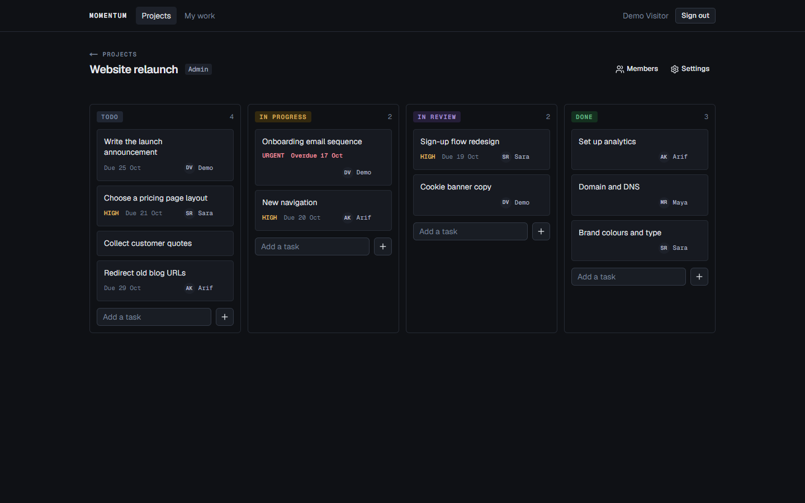
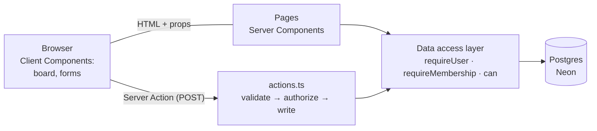
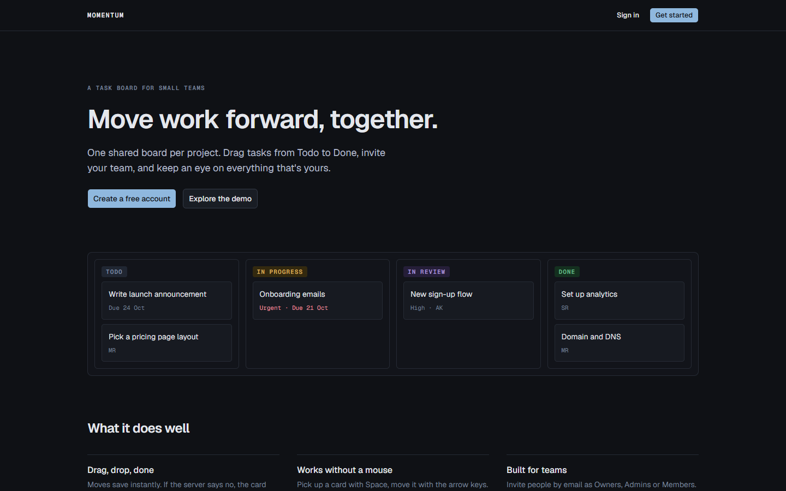
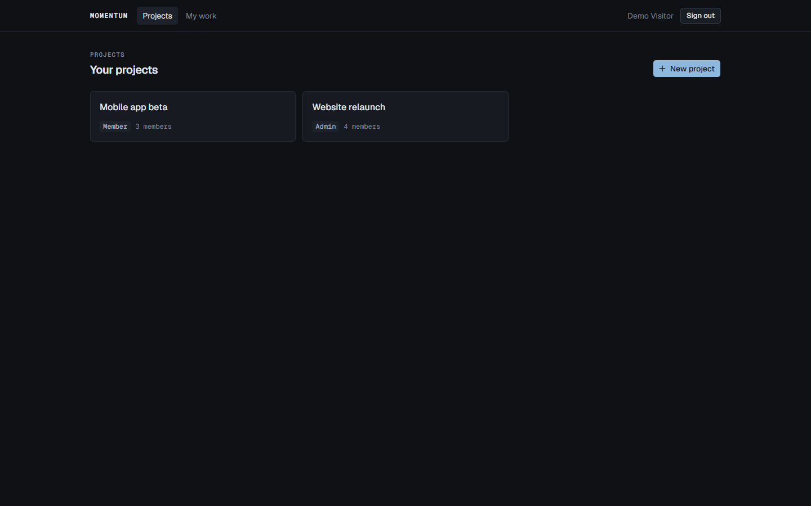
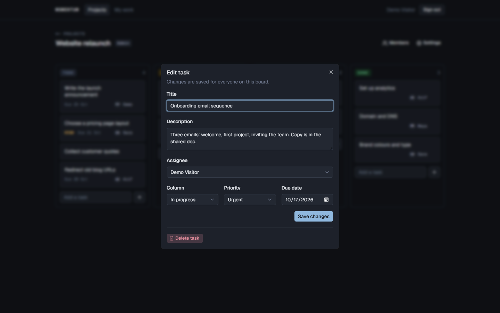
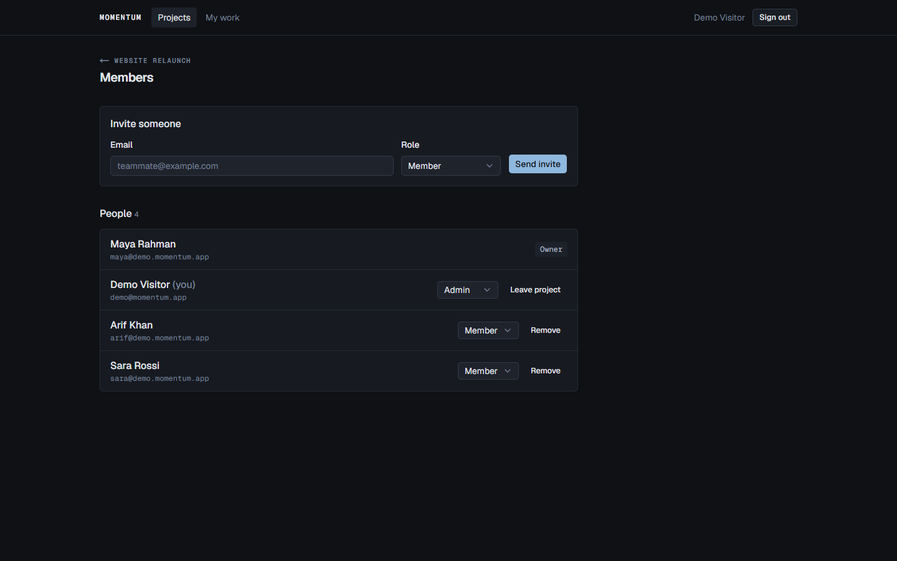
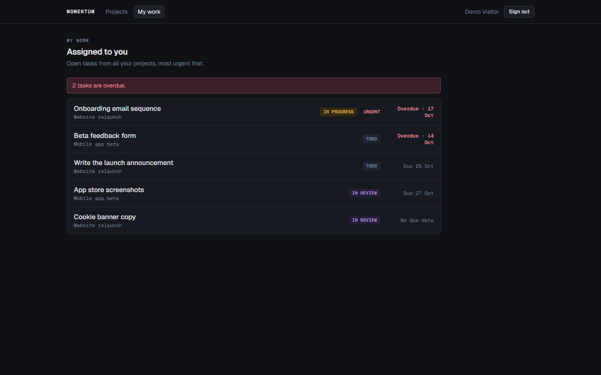
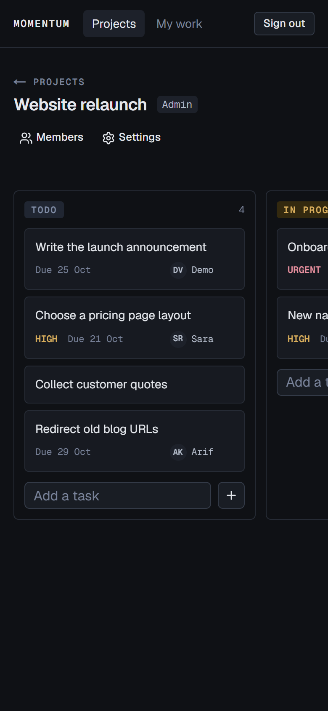

# Momentum

[](https://github.com/mohtasim22/momentum/actions/workflows/ci.yml)

A task board for small teams. Create a project, invite your teammates, and move
work from **Todo** to **Done** by dragging cards, with the mouse, by touch, or
from the keyboard.



**Try it:** the landing page has an **Explore the demo** button that signs you
into a seeded demo team, with no sign-up needed.

## Features

- **Drag-and-drop board.** Four columns; reorder within and between columns. Moves save instantly and **roll back with an explanation** if the server refuses (for example, when a teammate changed the board in the meantime).
- **Keyboard and screen-reader support.** Focus a card's handle, press <kbd>Space</kbd>, move with the arrow keys, drop with <kbd>Space</kbd>. Every step is announced ("Onboarding emails dropped at In review, position 1 of 2").
- **Teams and roles.** Invite by email (with a copyable link), roles **Owner / Admin / Member**, change roles, remove members. A project always keeps at least one owner.
- **Tasks.** Title, description, priority, due date, assignee. Overdue work is flagged in the viewer's own time zone.
- **My work.** Everything assigned to you across all projects, most urgent first.
- **Private by default.** Projects are invisible to non-members: a plain **404**, never a hint that they exist.

## Stack

|            |                                                                                                          |
| ---------- | -------------------------------------------------------------------------------------------------------- |
| App        | **Next.js 16** (App Router, Server Components, Server Actions), React 19, TypeScript                     |
| Data       | **PostgreSQL** on Neon, **Prisma 7** with the `pg` driver adapter                                        |
| Auth       | **Better Auth** (email + password, optional Google), HTTP-only database sessions                         |
| Validation | **Zod 4**, one schema shared by each form and its server action                                          |
| UI         | Tailwind CSS v4, shadcn/ui (Base UI), dnd-kit, sonner, lucide                                            |
| Email      | Resend (optional; invite links are always shown to the inviter)                                          |
| Quality    | Vitest (unit + integration against real Postgres), ESLint, Prettier, Husky + lint-staged, GitHub Actions |
| Hosting    | Vercel (`sin1`, next to the database) + Neon (Singapore)                                                 |

## Architecture

One Next.js app: there's no separate API server. Pages are Server Components
that read through a small **data access layer**. Every change goes through a
**Server Action** that validates, authorizes and writes.



```
src/
  app/                 routes only: thin pages, layouts, loading and error states
  features/<feature>/  schemas.ts (Zod) · queries.ts (reads) · actions.ts (writes) · components/
  lib/                 authz, permissions, position keys, dates, urgency, rate limits (pure + tested)
prisma/                schema, versioned SQL migrations, demo seed
test/integration/      server actions against a real database
```

## Decisions worth explaining

1. **Fixed columns as an enum, not a table.** No column CRUD to build, while keeping the interesting problems: ordering, moves and optimistic UI.
2. **Fractional positions.** Each card has a string key (`a0` < `a0V` < `a1`). Dropping a card between two others generates a key between theirs, so **a move updates one row**, however long the column. Float midpoints run out of precision after about 50 inserts in the same gap; string keys don't.
3. **`COLLATE "C"` on the position column.** The keys must compare byte by byte. Neon's default collation happens to, but the standard Postgres image (used in CI) sorts with English rules, where `'Zz' > 'a0'`. Prisma can't express collation, so the migration is hand-edited.
4. **The server computes positions.** The client sends only the task id, target column and the ids of the cards now above and below it. The server checks those neighbours belong to the same project and column, then generates the key from their real positions. A forged request can't write an arbitrary position.
5. **Ties are repaired, not refused.** Two people adding to the same column at once can get the same position. A drop between twins re-keys that column in one transaction.
6. **Optimistic UI with rollback.** The card moves instantly; if the server says no, the board restores its pre-drag snapshot, shows why, and refreshes from the server.
7. **One authorization choke point.** `requireMembership(projectId)` runs in every query and action (including `generateMetadata`, so a 404 page can't leak a project name in the tab title). Tasks, invites and memberships are always looked up **with the project id** (no IDOR).
8. **The last-owner rule is checked under a row lock.** `SELECT … FOR UPDATE` on the owner rows inside the transaction, so two owners demoting each other at the same moment can't leave a project ownerless. There's a test that fails without the lock.
9. **Invite tokens are stored hashed.** The email has the token; the database only has its SHA-256.
10. **Due dates are dates.** Stored as Postgres `DATE`, sent to the browser as `YYYY-MM-DD`, formatted in UTC, so "due 20 Oct" never shows as 19 Oct in another time zone. "Overdue" uses the viewer's own date.

## Security

Every page and action, what protects it, the tests that prove it, and what the
audit found are in **[SECURITY.md](SECURITY.md)**. The headline finding:
sign-in, being a Server Action, bypassed Better Auth's HTTP rate limiting, so
passwords could be guessed endlessly. It's now rate-limited per email and per IP
in the database, which all serverless instances share.

## Tests

```bash
npm test                  # 94 unit tests: permissions, positions, dates, urgency, board moves, tokens
npm run test:integration  # 27 tests against a real Postgres database
```

The integration suite runs the real server actions with only the Next.js request
layer stubbed. A second user attacks another team's project by URL and with
forged action arguments, two owners race to demote each other, invites are
accepted twice at once, and sign-in is brute-forced. Both suites were checked
against deliberately broken code: reintroducing an IDOR or removing the row lock
makes them fail.

The drag-and-drop flows (mouse, keyboard, cross-column, rollback on a stale
board, tie repair) were also exercised in a real browser.

## Running locally

Requirements: Node 24 and a Postgres database (a free [Neon](https://neon.tech) project works).

```bash
npm install
cp .env.example .env        # then fill in DATABASE_URL, TEST_DATABASE_URL, BETTER_AUTH_SECRET, DEMO_PASSWORD
npx prisma migrate deploy   # create the tables
npm run db:seed             # optional: demo team + demo login
npm run dev
```

`npm run check` runs formatting, lint, types and unit tests, the same as CI apart from the build.

## Deploying (Vercel + Neon)

1. In Neon, use the production branch's **pooled** connection string with `sslmode=verify-full`.
2. Import the repo in Vercel and set the environment variables: `DATABASE_URL`, `BETTER_AUTH_SECRET` (a new one, not the dev secret), `BETTER_AUTH_URL` (the production URL), `DEMO_PASSWORD`, and optionally `RESEND_API_KEY`, `EMAIL_FROM`, `GOOGLE_CLIENT_ID`, `GOOGLE_CLIENT_SECRET`.
3. Deploy. The `vercel-build` script runs `prisma migrate deploy` before `next build`, and `vercel.json` pins the functions to Singapore (`sin1`), next to the database.
4. Run the seed once against production (`DATABASE_URL=… npm run db:seed`) to create the demo team.

## Screenshots

|                                                        |                                                              |
| ------------------------------------------------------ | ------------------------------------------------------------ |
|        |                 |
|  |         |
|             |  |

---

Built by [Mohtasim Fahim](https://www.mohtasimfahim.com).
